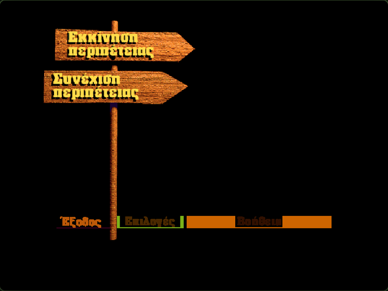
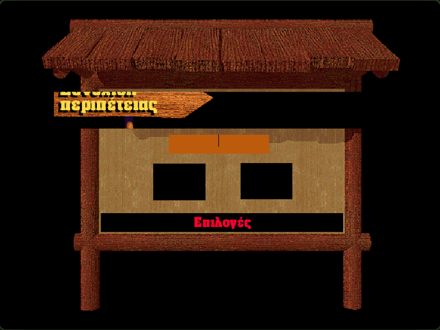

# Forestia: Η Μεγάλη Περιπέτεια (1998 Greek Edition)
### Digital Preservation & Reverse-Engineering Project

[](https://www.scummvm.org/)
[](LICENSE)
[](#)

A digital preservation and reverse-engineering effort to rescue **Forestia: Η Μεγάλη Περιπέτεια**, the beloved 1998 Greek point-and-click edutainment adventure game developed by **Kaiphea** and localized in Greece by **Εκδοτικός Οργανισμός Λιβάνη / Laser Media / Kaiphea**.

---

## 🌲 Visual Verification

| Main Menu (Αρχικό Μενού) | Save Game / Notice Board (Πίνακας Ανακοινώσεων) |
| :---: | :---: |
|  |  |
| *«Εκκίνηση περιπέτειας», «Συνέχιση περιπέτειας», «Έξοδος»* | *«Οι περιπέτειες που συνεχίζονται»* |

---

## 📜 Historical Context & The Preservation Problem

In 1998, French developer *Kaiphea* released *Forestia*, an educational point-and-click adventure combining pre-rendered 3D exploration, voice-acted wildlife encounters, and ecological mini-games. The Greek version, published by **Εκδοτικός Οργανισμός Λιβάνη**, introduced a generation of Greek children to computers and nature.

However, the game became completely unplayable on modern systems due to multiple legacy barriers:
1. **16-bit Installer & CD-ROM Checks**: The Windows 98/XP installer fails on 64-bit systems, and runtime hardcoded drive path checks abort if the physical CD is not mounted.
2. **Macromedia Director 6.5 Obfuscation**: The game assets are locked inside protected Director projector files (`.exe`, `.dxr`, `.cxt`) with compiled Lingo bytecode.
3. **The "MacGreek" Mojibake Barrier**: The Greek localization used legacy Apple MacGreek single-byte text encoding for Rich Text Cast Members (`RTE1`), while Windows builds defaulted to Windows-1252 or Windows-1253. On modern operating systems, Wine, and virtual machines, all Greek text rendered as unreadable garbled symbols (mojibake).

---

## 🔬 What Was Reverse-Engineered & Fixed

This project achieves **100% preservation fidelity without modifying a single byte of the original 1998 CD-ROM assets**:

1. **Native `kMacGreek` Text Engine**:
   - Implemented the complete 128-byte `kMacGreek` single-byte encoding lookup table (`0x80`–`0xFF` mapping directly to Unicode `U+0384`–`U+03CE`) in ScummVM core.
   - Connected Director 6 Rich Text (`RTE1`) cast decoding to cast-level encoding detection, ensuring authentic Greek typography displays natively across all operating systems.
2. **Director 6 Cast Resolution Bugfix**:
   - Fixed an unassigned cast library crash (`castLib == -1`) in Director 6 movie player when querying cast member IDs without explicit library indices.
3. **Copy Protection Bypass**:
   - Reverse-engineered the volume and file checks (`aaafores.txt` presence and root disc file checks) allowing seamless play directly from an ISO dump or extracted folder without requiring physical CD drives or virtual drive emulators.
4. **Dialogue & Script Extraction**:
   - Extracted and cataloged all **658** Greek dialogue strings, animal encyclopedia entries, UI labels, and puzzle instructions into structured JSON and text files in `docs/`.

---

## 🚀 How to Play

### Option 1: Web Browser (Zero Install)
You can play the Greek version directly in any modern web browser (Chrome, Firefox, Safari, Edge) via the live WebAssembly build on GitHub Pages:
> 🎮 **[Play Forestia in Browser](https://plympe.com/forestia-greek-adventure/)** *(Mirror: [panlybero.github.io/forestia-greek-adventure](https://panlybero.github.io/forestia-greek-adventure/))*

### Option 2: Linux / macOS / Windows Desktop
1. Clone this repository:
   ```bash
   git clone https://github.com/panlybero/forestia-greek-adventure.git
   cd forestia-greek-adventure
   ```
2. Extract your original Greek *Forestia* CD-ROM / ISO into a directory (e.g. `iso_contents/`).
3. Run the asset organizer tool to normalize case-sensitivity:
   ```bash
   python3 tools/organize_iso_assets.py path/to/iso_contents game_data
   ```
4. Launch the game using the desktop launcher:
   ```bash
   ./run_forestia.sh game_data
   ```

---

## 📁 Repository Structure

```
forestia-greek-adventure/
├── docs/
│   ├── reverse_engineering_report.md  # Complete technical analysis & file structures
│   ├── greek_strings.txt              # All 658 extracted Greek dialogue lines
│   ├── greek_strings.json             # Structured JSON dialogue database
│   └── screenshots/                   # In-engine visual verification captures
├── patches/
│   └── scummvm-greek-forestia.patch   # Upstream-ready ScummVM preservation patch
├── tools/
│   ├── extract_texts.py               # Dialogue and text extractor from FTEXTES.Cxt
│   └── organize_iso_assets.py         # CD-ROM asset extraction and normalization
├── bin/                               # Standalone binaries
└── run_forestia.sh                    # One-click desktop launcher
```

---

## 🗺️ Long-Term Roadmap

- [x] **Phase 1: Digital Preservation**
  - [x] Asset extraction and CD protection bypass.
  - [x] ScummVM `kMacGreek` single-byte encoding engine.
  - [x] In-engine Greek font and text verification.
  - [x] Desktop launcher and standalone distribution bundle.
  - [ ] GitHub Pages WebAssembly (Wasm) browser deployment.
  - [ ] Submit clean patch to official upstream ScummVM.
- [ ] **Phase 2: Modern Engine Port (Godot 4)**
  - Reconstruct the game natively in Godot 4 using decompiled Lingo scripts and extracted audio/art assets for native 4K scaling and mobile/tablet support.
- [ ] **Phase 3: Real-Time 3D Forest Remake**
  - Re-imagine the 1998 pre-rendered scenes as a continuous, walkable real-time 3D first-person forest in Godot 4 / Unreal Engine, preserving the original Greek voice acting and sound effects.

---

## ⚖️ Legal & Disclaimer

*Forestia: Η Μεγάλη Περιπέτεια* is © 1998 Kaiphea / Εκδοτικός Οργανισμός Λιβάνη / Laser Media. This project is created strictly for non-commercial historical preservation, accessibility, and educational purposes under abandonware conventions. All reverse-engineered patches, tools, and scripts are licensed under GNU General Public License v2.0.
